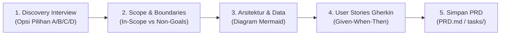

# PRD Generator (Spec-Driven Architecture Skill)

Keahlian tingkat senior untuk merancang **Product Requirements Document (PRD)** dan **Spesifikasi Arsitektur Sistem** standar industri teknologi global (mengadopsi metodologi Lenny Rachitsky & Shreyas Doshi).

Skill ini mengubah ide kasar atau kebutuhan bisnis menjadi spesifikasi teknis yang teruji, presisi, dan siap dieksekusi oleh tim developer maupun AI coding agent tanpa ambiguitas logika.

---

## 🧭 Alur Kerja 5 Fase (Standard Operating Procedure)



### Fase 1: Wawancara Klarifikasi Singkat (Discovery Interview)
Jangan pernah langsung menebak jika kebutuhan masih ambigu. Ajukan **3–5 pertanyaan kunci** yang wajib dijawab pengguna, formatlah dengan **opsi berhuruf (A, B, C, D)** agar pengguna bisa merespons cepat (misal hanya mengetik: `"1A, 2B, 3C"`):

```text
1. Apa tujuan bisnis utama (Primary Goal) dari fitur/sistem ini?
   A. Meningkatkan konversi / adopsi pengguna baru
   B. Efisiensi operasional & memangkas waktu proses manual
   C. Keamanan, kepatuhan regulasi, & audit data
   D. Lainnya: [sebutkan]

2. Siapa target pengguna utamanya (Target Persona)?
   A. Pengguna publik / pasien umum
   B. Petugas operasional / staf internal
   C. Administrator / tim teknis
   D. Multi-peran (publik & staf terpisah)

3. Skala dan batas implementasi (Scope Horizon):
   A. MVP (Minimal Viable Product) tercepat untuk validasi
   B. Fitur lengkap siap produksi (Full Production Grade)
   C. Hanya sisi Backend API & Database
   D. Hanya sisi Frontend antarmuka pengguna
```

---

### Fase 2: Aturan Penyusunan PRD Standar Pro

Setiap dokumen PRD yang dibuat **WAJIB** memiliki struktur bab berikut:

```markdown
# PRD: [Nama Fitur / Sistem]

## 1. Executive Summary & Problem Statement
- **Latar Belakang:** Masalah nyata apa yang dihadapi saat ini?
- **Solusi yang Diajukan:** Ringkasan solusi yang akan dibangun.
- **Nilai Bisnis & Sasaran:** Dampak positif langsung bagi organisasi/pengguna.

## 2. Metrik Keberhasilan (KPI / Success Metrics)
- Metrik kuantitatif terukur (misal: "Waktu antrean berkurang 40%", "Tingkat error login < 0.1%").

## 3. Batasan Tegas: In-Scope vs Non-Goals (Out of Scope)
> [!IMPORTANT]
> Mencegah Scope Creep: Tuliskan secara eksplisit apa yang **TIDAK** dibuat pada rilis ini.
- **In-Scope (Dikerjakan):** Fitur utama fase ini.
- **Non-Goals (TIDAK Dikerjakan Sekarang):** Fitur yang sengaja ditunda ke fase rilis berikutnya.

## 4. User Personas & User Journeys
- Persona pengguna utama dan langkah-langkah alur interaksi dari awal hingga selesai.

## 5. Functional Requirements (FR) & User Stories
Setiap kebutuhan fungsional diberi kode berurut (`FR-01`, `FR-02`) dan dijabarkan dalam User Stories dengan kriteria penerimaan **Gherkin (Given-When-Then)**:

### US-001: [Judul Cerita Pengguna]
**Sebagai** [tipe user], **saya ingin** [aksi/kemampuan] **agar** [manfaat].

**Acceptance Criteria (Kriteria Pengujian):**
- [ ] **Given:** [Kondisi prasyarat awal]
- [ ] **When:** [Tindakan yang dilakukan user/sistem]
- [ ] **Then:** [Hasil yang terverifikasi dan dapat diuji]
- [ ] Validasi error / Edge case tertangani dengan pesan yang jelas.

## 6. Non-Functional Requirements (NFR)
- **Performa:** Latensi respon API (misal < 500 ms).
- **Keamanan:** Autentikasi (JWT/OAuth), enkripsi kata sandi (Bcrypt), proteksi SQL Injection & XSS.
- **Ketersediaan & Reliabilitas:** Backup data, retry mechanism koneksi database.

## 7. Arsitektur Sistem & Data Modeling (Mermaid Diagram)
- **Diagram Alur (Flowchart / Sequence Diagram):** Alur interaksi request/response.
- **Skema Basis Data (Entity-Relationship Diagram / ERD):** Struktur tabel dan relasi foreign key.

## 8. Rencana Rilis & Milestone Teknis
- **Milestone 1:** Skema database & API backend endpoint.
- **Milestone 2:** Implementasi UI & state management frontend.
- **Milestone 3:** Integrasi end-to-end, testing, dan validasi keamanan.
```

---

### Fase 3: Panduan Bahasa & Gaya Penulisan
1. **Verifiable (Dapat Diuji):** Hindari kata samar seperti *"sistem harus cepat"* atau *"form harus bagus"*. Ganti dengan: *"Response time < 300ms"* dan *"Form memvalidasi format email sebelum submit"*.
2. **Kemandirian (Self-Contained):** Developer atau AI agent yang membaca dokumen ini harus bisa langsung mengoding tanpa perlu bertanya-tanya lagi tentang alur logika dasarnya.
3. **Penyimpanan Dokumen:**
   - Untuk proyek tunggal: simpan sebagai `PRD.md` di root proyek.
   - Untuk fitur bertahap: simpan di `tasks/prd-[nama-fitur].md`.

