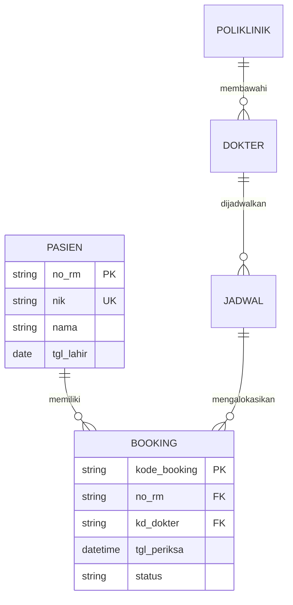

# 🏢 Template PRD: Sistem Enterprise & Web Skala Besar

Gunakan template ini saat merancang sistem internal perusahaan, sistem informasi rumah sakit (SIMRS), ERP, atau portal administrasi multi-peran.

---

```markdown
# PRD: [Nama Modul / Sistem Enterprise]

## 1. Executive Summary & Business Value
- **Business Need:** Latar belakang kebutuhan bisnis perusahaan.
- **ROI & Efisiensi:** Proyeksi penghematan waktu staf atau pengurangan risiko salah input data.

## 2. Hak Akses & Matriks Wewenang (RBAC - Role Based Access Control)
| Peran (Role) | Hak Melihat (Read) | Hak Mengubah (Write) | Hak Menyetujui (Approve) | Hak Menghapus (Delete) |
| :--- | :---: | :---: | :---: | :---: |
| **Petugas / Operator** | ✅ | ✅ | ❌ | ❌ |
| **Supervisor / Dokter** | ✅ | ✅ | ✅ | ❌ |
| **Super Administrator** | ✅ | ✅ | ✅ | ✅ (Soft Delete) |

## 3. Spesifikasi Fungsional (FR)
- **FR-01: Validasi Integritas Data:** Sistem wajib memvalidasi kesesuaian foreign key antar tabel sebelum transaksi disimpan.
- **FR-02: Jejak Audit (Audit Trail):** Setiap perubahan data penting wajib mencatat `created_by`, `updated_by`, `ip_address`, dan timestamp di tabel log.
- **FR-03: Export & Pelaporan:** Mendukung ekspor data tabular ke format Excel (XLSX) dan PDF berstandar cetak.

## 4. Kriteria Non-Fungsional (NFR)
- **Kapasitas Beban:** Mampu menangani hingga 500 transaksi konkuren bersamaan.
- **Latency SLA:** 95% request API selesai di bawah 400 ms.
- **Ketahanan:** Database replication aktif (Master-Slave / Primary-Replica).

## 5. Non-Goals (Batasan Cakupan)
- Tidak mencakup integrasi billing ke pihak asuransi swasta tier 3.
- Tidak mencakup pengarsipan data historis lebih dari 5 tahun lampau.

## 6. Pemodelan Data Relasional (Mermaid ERD)

```
