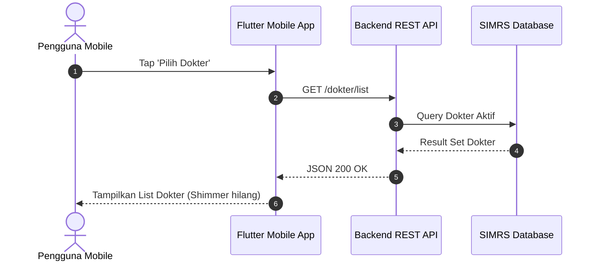

# 📱 Template PRD: Aplikasi Mobile (Flutter / React Native / iOS / Android)

Gunakan template ini saat merancang fitur atau aplikasi mobile yang berorientasi pada interaksi layar sentuh, status offline/online, dan pengalaman native pengguna.

---

```markdown
# PRD: [Nama Aplikasi / Modul Mobile]

## 1. Overview & Problem Statement
- **Konteks:** Masalah pengguna mobile yang ingin diselesaikan.
- **Solusi Mobile:** Pengalaman native/hybrid yang dibangun (misal: reservasi rawat jalan mandiri).

## 2. Platform & Lingkungan Target
- **Target OS:** Android (Min SDK: 24 / Android 7.0+), iOS (iOS 14.0+).
- **Orientasi:** Portrait Lock.
- **Konektivitas:** Online-first dengan caching status offline (SharedPreferences/Hive).

## 3. User Stories & Kriteria Penerimaan (Gherkin)

### US-M01: [Nama Alur Mobile]
**Sebagai** pengguna mobile, **saya ingin** [fitur mobile] **agar** [tujuan].

**Kriteria Penerimaan (Acceptance Criteria):**
- [ ] **Given:** Pengguna telah login dan memiliki token sesi aktif.
- [ ] **When:** Pengguna menekan tombol 'Pesan Antrean'.
- [ ] **Then:** Sistem menampilkan bottom sheet pemilihan tanggal dan dokter.
- [ ] **And:** Haptic feedback ringan terpicu saat kartu terpilih.
- [ ] **Edge Case:** Saat koneksi terputus, tampilkan banner koneksi offline dan tombol 'Coba Lagi'.

## 4. Spesifikasi UI/UX & Interaksi
- **Loading State:** Shimmer effect (bukan spinner blocking layar penuh).
- **Error Handling:** Floating SnackBar dengan tombol 'Tutup' atau 'Coba Lagi'.
- **Touch Target:** Minimum 44x44 dp untuk seluruh elemen interaktif tombol/icon.
- **Keyboard Handling:** Auto-scroll saat keyboard virtual muncul agar input tidak tertutup.

## 5. Non-Goals (Out-of-Scope Rilis Ini)
- Tidak mendukung pembayaran in-app payment gateway (pembayaran manual di kasir RS).
- Tidak mendukung push notifikasi background saat aplikasi dihentikan paksa (force closed).

## 6. Diagram Alur Mobile (Mermaid)

```

