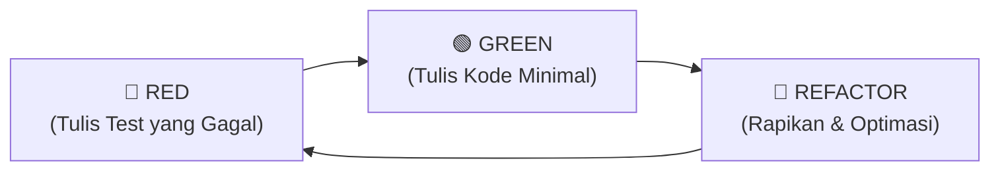

# 🧪 Test Harness & TDD Skill

Skill ini membekali AI dengan metodologi pengujian otomatis (*Automated Verification Harness*) berstandar industri. Tidak ada kode yang dianggap selesai tanpa memiliki *test harness* yang memverifikasi perilakunya.

---

## 🎯 Mengapa Harus Menggunakan Test Harness?

1. **Mencegah Regresi (Regression Safety):** Setiap penambahan fitur baru dijamin tidak merusak (*break*) alur yang sudah ada.
2. **Deterministic Feedback Loop:** AI tidak menebak apakah kodenya berhasil. AI mengeksekusi test suite, membaca log hasil pengujian, dan memperbaiki diri (*self-healing*) jika ada kegagalan.
3. **Dokumentasi Hidup (Executable Specs):** Berkas test berfungsi sebagai spesifikasi teknis paling akurat tentang bagaimana suatu fungsi seharusnya merespon berbagai input.

---

## 🔄 Siklus TDD 3-Fase (Red - Green - Refactor)

1. **🔴 RED (Fase Uji Gagal):**
   * Buat berkas tes di dalam direktori `test/`.
   * Definisikan skenario yang diharapkan (Happy Path, Error 401, Timeout, Server 500, Payload Kosong).
   * Jalankan tes -> **Wajib Gagal** (karena fungsi target belum diimplementasikan atau belum lengkap).

2. **🟢 GREEN (Fase Implementasi Minimal):**
   * Tulis kode implementasi sesederhana mungkin hanya agar tes berubah warna menjadi hijau (PASS).
   * Hindari menambahkan kode yang tidak diminta oleh tes.

3. **🔵 REFACTOR (Fase Penyempurnaan):**
   * Rapikan struktur kode, hapus duplikasi, perbaiki penamaan variabel.
   * Jalankan tes kembali -> Pastikan tes **tetap HIJAU (PASS)**.

---

## 📐 Piramida Pengujian (Testing Pyramid)

Setiap proyek wajib menyeimbangkan pengujian:
* **70% Unit Tests (Cepat, Murah, Terisolasi):** Menguji *business logic*, *service*, parser model JSON, dan fungsi utilitas murni. Semua ketergantungan luar (HTTP client, database, bluetooth) di-*mock*.
* **20% Integration / Widget Tests:** Menguji interaksi antar komponen (misal: tombol ditekan -> memicu *state change* -> menampilkan *snackbar error*).
* **10% End-to-End (E2E) Tests:** Alur utuh pengguna dari login sampai selesai transaksi.

---

## 🛠️ Standar Mocking (No Real Network Calls in Tests)

Saat menulis pengujian:
1. **DILARANG KERAS** memanggil API server asli atau database produksi.
2. Gunakan pustaka mocking modern (seperti **`mocktail`** untuk Flutter/Dart atau **`unittest.mock`** untuk Python):
   * Buat class tiruan: `class MockHttpClient extends Mock implements http.Client {}`
   * Siapkan stub kondisi: `when(() => mockClient.post(...)).thenAnswer((_) async => http.Response('{"status": "ok"}', 200));`
   * Uji kondisi kegagalan:
     * *Kasus Timeout:* `when(...).thenThrow(TimeoutException('Connection timed out'));`
     * *Kasus 401 Unauthorized:* `when(...).thenAnswer((_) async => http.Response('{"error": "Unauthorized"}', 401));`
     * *Kasus 500 Internal Server Error:* `when(...).thenAnswer((_) async => http.Response('Server Error', 500));`

---

## 📋 Prosedur Verifikasi Kode untuk AI

Sebelum AI menyerahkan kode baru kepada user:
1. Buat berkas pengujian yang mencakup:
   - ✅ **Happy Path** (Data valid, respon server 200 OK).
   - ⚠️ **Edge Case 1: Bad Input** (Format nomor HP salah, OTP kurang digit).
   - ⚠️ **Edge Case 2: Network Glitch** (Koneksi putus di tengah jalan).
   - ⚠️ **Edge Case 3: Server Failure** (Respon 500 atau JSON berantakan).
2. Tunjukkan struktur pengujian dan instruksi cara menjalankannya (misal: `flutter test test/services/pendaftaran_service_test.dart`).

---

## 📚 Referensi Tersedia
* [flutter-mocktail-harness.md](file:///D:/agents-skills/skills/test-harness/references/flutter-mocktail-harness.md) - Panduan praktis implementasi test harness di Flutter menggunakan `mocktail`.
* [api-service-test-template.md](file:///D:/agents-skills/skills/test-harness/references/api-service-test-template.md) - Template pengujian lengkap untuk HTTP service (OTP, Auth, Pendaftaran).
* [tdd-workflow-cheatsheet.md](file:///D:/agents-skills/skills/test-harness/references/tdd-workflow-cheatsheet.md) - Checklist dan cheat sheet langkah TDD untuk developer/AI.
